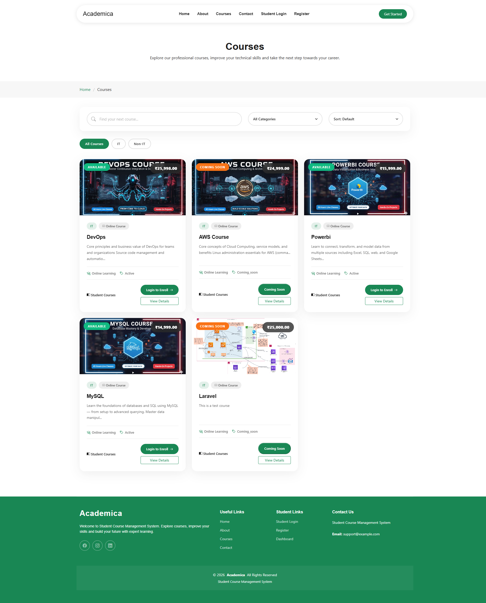
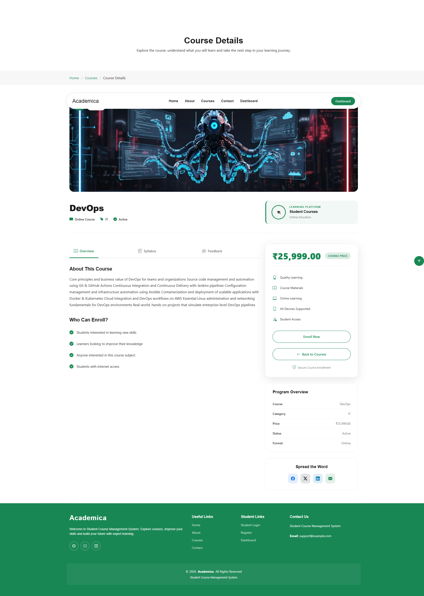
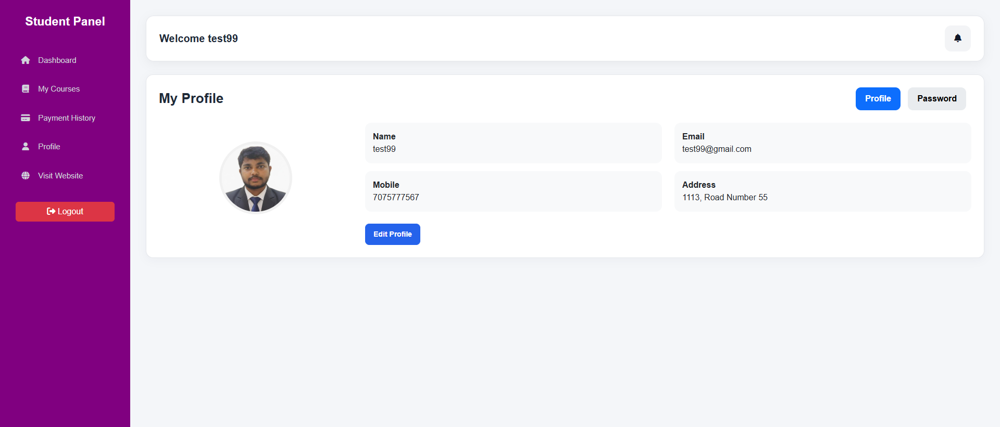
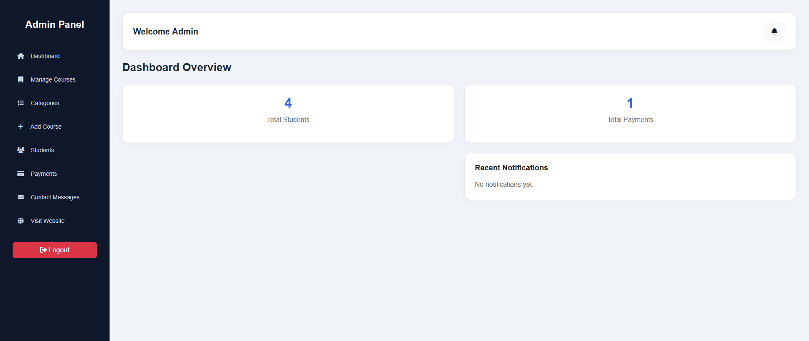
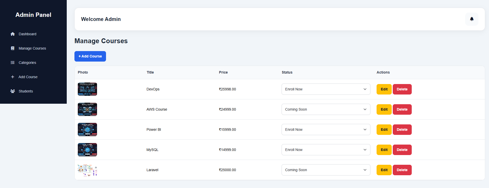

🎓 Student Course Management System

A complete web-based Student Course Management System developed using Laravel. This application provides separate Admin and Student modules to manage courses, students, payments, and notifications.

🌐 Project Overview

The Student Course Management System simplifies course administration and student enrollment through an easy-to-use and responsive interface.

✨ Features
👨‍💼 Admin Module
Secure Admin Login
Admin Dashboard
Create, Update and Delete Courses
Manage Course Categories
Student Management
Payment Management
Contact Message Management
Notification Management
🎓 Student Module
Student Registration and Login
Forgot Password
Student Dashboard
Browse Available Courses
My Courses
Payment History
Profile Management
🚀 Additional Features
Razorpay Payment Integration
PDF Invoice Download
Course Search and Category Filtering
Course Details Page
Notification System
Responsive User Interface
🖥️ Screenshots

### Home Page

### Courses Page

### Course Details

### Student Dashboard

### Admin Dashboard

### Manage Courses

🛠️ Technologies Used
Technology	Purpose
Laravel 12	Backend Framework
PHP 8.2	Server-side Programming
MySQL	Database
Bootstrap 5	Frontend Framework
JavaScript	Interactive UI
HTML5 & CSS3	Web Design
Razorpay	Payment Integration
⚙️ Installation
1. Clone Repository
bash
git clone https://github.com/sureshchenchala707-ai/student-course-management-system.git

2. Navigate to Project
bash
cd student-course-management-system

3. Install Dependencies
bash
composer install
npm install

4. Configure Environment
bash
cp .env.example .env
php artisan key:generate

Configure your database credentials in the .env file:

env
DB_CONNECTION=mysql
DB_HOST=127.0.0.1
DB_PORT=3306
DB_DATABASE=student_course_management
DB_USERNAME=root
DB_PASSWORD=

5. Create Database

Create a MySQL database named:

student_course_management

6. Run Migrations
bash
php artisan migrate

7. Create Storage Link
bash
php artisan storage:link

8. Start Development Server
bash
php artisan serve

Open your browser:

http://127.0.0.1:8000

📁 Project Structure
text
student-course-management-system/
├── app/
│   └── Http/Controllers/
├── database/
│   └── migrations/
├── public/
│   ├── css/
│   ├── uploads/
│   └── profiles/
├── resources/
│   └── views/
├── routes/
│   └── web.php
├── screenshots/
├── .env.example
└── README.md

🔐 Security
Environment credentials are excluded from Git.
Authentication for Admin and Student modules.
Server-side request validation.
👨‍💻 Author

Suresh Chenchala

GitHub: @sureshchenchala707-ai

📄 License

This project is available for educational and portfolio purposes.
